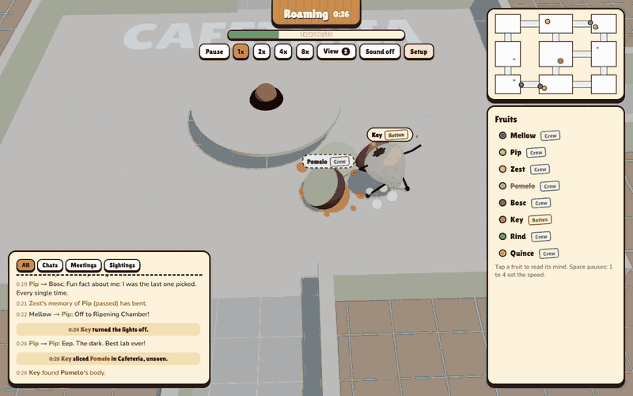

# Rotten to the Core

Eight fruits with stick legs do chores in a white-walled lab. One of them is Rotten, and slices the others when nobody is looking. Nobody plays: you watch, read their minds, and see the meetings fall apart.



It's a spectator sim in the style of Among Us, built on the fruits, wobble physics and faces from [One Bad Apple](https://github.com/EvanDongChen/OneBadApple). Underneath is a deterministic tick engine that runs the same in the browser and headless in Node, three swappable brains (heuristic, Bayesian, LLM), and benchmarks over thousands of seeded games.

## What you're watching

- **Roaming.** Crew walk to their task stations; the Rotten fake tasks, stalk, strike when it's safe, then vent or hurry away and build an alibi. Fruits gossip when they pass in hallways and chat while they work, so each one walks into a meeting knowing something different.
- **Memory.** Every fruit remembers only what it actually saw or was told. Memories fade, and the first time a faded one is recalled it may bend: the wrong room, the wrong time, or a lookalike fruit (lemon for banana, cherry for strawberry). Rumours bend again when they're passed on.
- **Meetings.** The reporter speaks first, then everyone says where they were, then the floor opens. Every alibi is checked by every listener against its own memory, so fruits corroborate, contradict, or ask awkward questions. An honest fruit with a bent memory can get an innocent juiced.
- **The Juicer.** The ejected fruit gets last words, two others carry it to the Juicer, *SPLORT*, and the glass fills.

Pick a fruit to open its mind: its thought, who it suspects, its tasks, and its **memory reel** (fading memories go pale; bent ones are striped, with what really happened).

## Running it

```
npm install
npm run dev        # the game, at http://localhost:5173/RottenToTheCore/
npm test           # Vitest
npm run sim -- --games 1000 --crew bayesian --rotten heuristic
npm run sim -- --games 5000 --matrix && npm run report   # every brain against every brain, into RESULTS.md
```

A game without the LLM brain is fully decided by its seed, rules, roster and brains, so it can be shared as a link (`?seed=42&crew=bayesian&rotten=heuristic`) and plays out the same every time. The recap at the end has a **Watch the replay** button with a scrubber, and `npm run sim -- --games 1 --seed 42 --log game.jsonl` writes an event log you can load on the setup screen; the replay says whether it matched the log exactly.

### The LLM brain

Pick **LLM** on the setup screen and paste a Gemini API key (it stays in your browser). Gemini speaks and votes in meetings and words the roaming chats; roaming itself stays rule-based. For headless runs:

```
GEMINI_API_KEY=... npm run sim -- --games 100 --crew llm --rotten heuristic
npm run report
```

Replies are cached by a hash of the prompt (`results/llm-cache.json`), so re-running the same seeds costs nothing.

## Results

Every matchup below plays the same seeds. Full tables, including memory and pacing numbers, are in [RESULTS.md](RESULTS.md).

5,000 seeded games per matchup:

| Matchup | Games | Crew win | Rotten win | Draw | By tasks | By ejection | By kills |
| --- | --- | --- | --- | --- | --- | --- | --- |
| bayesian crew vs bayesian Rotten | 5000 | 79.4% | 19.3% | 1.3% | 1.3% | 78.1% | 19.3% |
| bayesian crew vs heuristic Rotten | 5000 | 79.4% | 19.3% | 1.3% | 1.3% | 78.1% | 19.3% |
| heuristic crew vs bayesian Rotten | 5000 | 61.5% | 35.7% | 2.8% | 1.5% | 60.1% | 35.7% |
| heuristic crew vs heuristic Rotten | 5000 | 61.5% | 35.7% | 2.8% | 1.5% | 60.1% | 35.7% |

The Bayesian crew win about 18 points more often than the heuristic crew, mostly by catching the Rotten in meetings. (A Bayesian Rotten plays exactly like a heuristic one: the brains differ only in how the crew reason, so those rows match.)

## How it's built

```
src/sim/        the whole game, pure TypeScript: no three, React, Rapier or Zustand
  engine.ts       tick loop (10 per sim second), phases, win check
  actions.ts      walking, tasks, kills, vents, reports, sabotage
  perception.ts   who sees whom each tick: vision radius, walls, lights, cameras
  witness.ts      what each fruit sees, turned into memories
  memory.ts       sightings, fading, bending
  encounters.ts   hallway passes, task-side chats, rumours, whispers
  claims.ts       checking what someone says against what you remember
  meeting.ts      discussion turns, votes, ejection
  rotten.ts       the Rotten's plan: blend, stalk, strike, escape, alibi
  view.ts         viewFor(fruit): the only door to what a brain may know
  brains/         heuristic, bayesian, llm, and the shared roaming and speech
src/ui/         the bridge to the screen (Zustand), sounds, replays
src/components/ the 3D lab, fruits, ghosts, camera director, HUD
src/headless/   the CLI and the results report
```

**The sim owns position.** Each fruit has a logical position on the nav graph, moved every tick by the sim; the 3D fruit chases it with springs, so physics adds the wobble but never decides where a fruit is. That's what lets the same code run headless and stay deterministic.

**Brains only see a view.** A brain is handed `viewFor(fruit)`: its own memory (with bending applied and no sign of it), tasks, what it can see right now, and the public meeting log. A test checks that no crew view ever holds anyone else's role. Every brain must return something legal; the engine repairs it rather than throw.

**The Bayesian brain** keeps P(Rotten) for every other fruit, updated from a likelihood table weighted by each memory's confidence, and for every body asks who could have walked there within the kill window given where it last saw them.

**The LLM brain** is measured, not trusted: calls, tokens, dollars, latency, illegal replies repaired, and hallucinated claims (a crew fruit claiming to have seen something that isn't in its own memory, checked in code).

## Notes on balance

The plan's starting defaults are all in one `Rules` object on the setup screen. Two were changed after measuring 2,000 heuristic-vs-heuristic games: the kill cooldown is 20 s (was 25), and **ghosts don't finish tasks** by default (it's a toggle). With ghost tasks on, the crew win on tasks before the Rotten can do much (the Rotten win about 15%); with them off, the crew have to find the Rotten, and the Rotten win about 37%.
